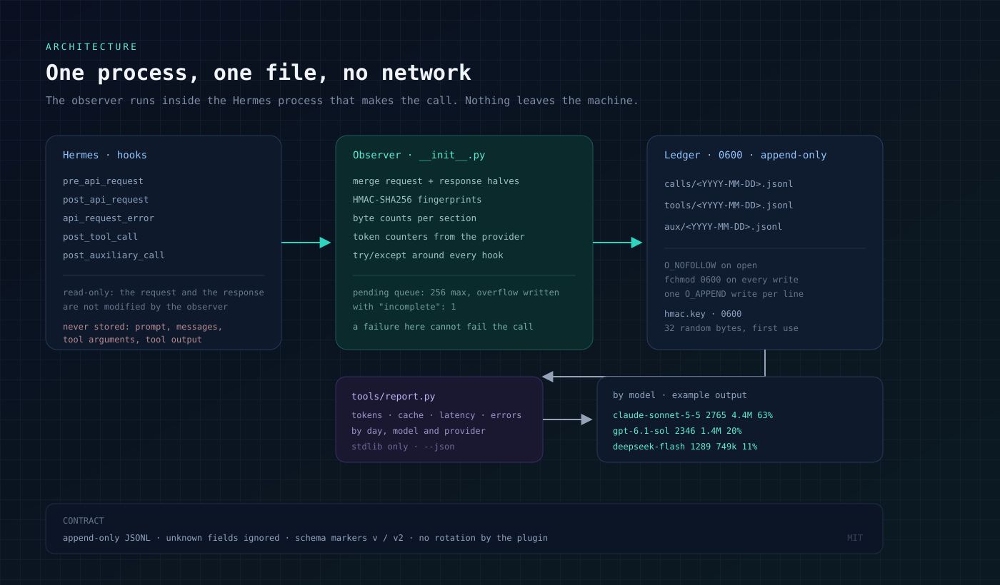

# hermes-efficiency-plugin

Local, dependency-free usage telemetry for [Hermes Agent](https://hermes-agent.nousresearch.com/docs): one JSON
line per model call, tool call and auxiliary call, plus a CLI that turns those lines into a token, cache and
latency report. No network, no vendor service, no dashboard to host — the ledger is a file you own.

The plugin observes; it never changes a request or a response. Every hook is wrapped so that a failure in the
observer cannot break the model call.

## How it works



## What it records

Per model call (`eficiencia/calls/<YYYY-MM-DD>.jsonl`), one JSON object:

| field | meaning |
|---|---|
| `ts`, `t0`, `dur`, `ttfb` | start, duration and time-to-first-byte of the call, in seconds |
| `model`, `provider`, `api_mode`, `resp_model` | what answered |
| `profile`, `platform`, `session`, `task` | where it ran; identifiers, never content |
| `n_msgs`, `bytes`, `req_chars`, `approx_tok` | size of the request |
| `h_full`, `h_sys`, `h_last` | HMAC-SHA256 fingerprints of the whole request, the system prompt and the last message |
| `sys_b`, `skills_b`, `m_sys`, `m_user`, `m_asst`, `m_tool`, `memctx_b`, `rules_n`, `tools_n` | bytes per section and counts |
| `usage` | token counters reported by the provider (input, output, cache read, cache write, reasoning, total) |
| `finish`, `out_chars`, `tool_calls` | how it ended |
| `err`, `err_type`, `status` | failure flag and classification, on error records |

Per tool call (`eficiencia/tools/<day>.jsonl`): tool name, duration, result size in characters and status; for
skill tools, the skill name. Per auxiliary call (`eficiencia/aux/<day>.jsonl`): auxiliary task, model, tokens,
duration.

**Never recorded:** prompt text, message text, tool arguments, tool output, model output, card text, credentials.
The request itself is fingerprinted with a local random key (`eficiencia/hmac.key`, 96 effective bits) so two
identical requests can be recognised later without the text being stored.

Server-wide totals need no identification, but the ledger does contain local identifiers (profile name, session
id, task id) in clear. Read [docs/PRIVACY.md](docs/PRIVACY.md) before pointing it at data you must not keep.

## Install

```bash
hermes plugins install smurilosrocha/hermes-efficiency-plugin --ref <40-char-sha>
hermes plugins enable eficiencia
```

Installing by `owner/repo` without `--ref` takes the default branch; prefer a pinned full commit SHA, which is
what the catalog pins. The plugin is loaded on the next Hermes start.

Requirements: Hermes Agent `>=0.21.7` (the version that fires `post_auxiliary_call`); tested on `0.22.5`. Python
3.10+; the plugin and the report use the standard library only.

## Report

```bash
python3 tools/report.py                 # last 7 days
python3 tools/report.py --days 30
python3 tools/report.py --json > usage.json
```

The script reads `<hermes-root>/eficiencia/calls/*.jsonl` and prints calls, tokens (input, cache read, cache
write, output), latency p50/p95 and errors by type, grouped by day, model and provider. Shape of the output:

```
janela: últimos 7 dias · chamadas: 3 · erros: 1
tokens: entrada 300 · cache lido 900 · cache escrito 0 · saída 120
latência das chamadas bem-sucedidas: p50 1.00s · p95 3.00s (2 medidas)

por dia
dia         chamadas  entrada  cache lido  saída  erros
----------  --------  -------  ----------  -----  -----
2026-11-05         3      300         900    120      1

por modelo
modelo  chamadas  entrada  saída  % saída  erros
------  --------  -------  ------  -------  -----
m1             3      300    120     100%      1
```

`--root` points at a different Hermes root; `EFICIENCIA_ROOT` does the same for the plugin. The CLI is a
reference consumer, not the only possible one: the JSONL schema is documented in
[docs/DATA-FORMAT.md](docs/DATA-FORMAT.md), so a dashboard, a spreadsheet or a billing check can read the same
files.

## Disclosure

Installing and enabling the plugin is the consent step: from then on, **every** model, tool and auxiliary call
on this machine is recorded locally, including the profile name, session id and task id in clear. Nothing is sent
anywhere and no prompt or tool text is stored, but the ledger is a record of what the machine did and when — see
[docs/PRIVACY.md](docs/PRIVACY.md). Collection stops with `hermes plugins disable eficiencia` or `EFICIENCIA_OFF=1`.

## Where the data goes, and how to stop it

- Ledger: `<hermes-root>/eficiencia/calls|tools|aux/<day>.jsonl`, mode `0600`, directory `0700`. The root is
  shared by every profile on the machine, so one ledger covers all agents.
- HMAC key: `<hermes-root>/eficiencia/hmac.key`, mode `0600`, generated on first use.
- Disable: `hermes plugins disable eficiencia`, or set `EFICIENCIA_OFF=1` for a single process.
- Delete: remove the `eficiencia/` directory. Nothing is written anywhere else.

The plugin refuses to append through a symbolic link and re-applies `0600` on every write, so a pre-existing
world-readable file does not stay world-readable.

## Security

Report vulnerabilities privately through GitHub's *Report a vulnerability* in the Security tab — see
[SECURITY.md](SECURITY.md). The observer handles prompt material transiently to compute fingerprints; the threat
model, the storage guarantees and the known limits are in [docs/THREAT-MODEL.md](docs/THREAT-MODEL.md).

## License

MIT — see [LICENSE](LICENSE).
